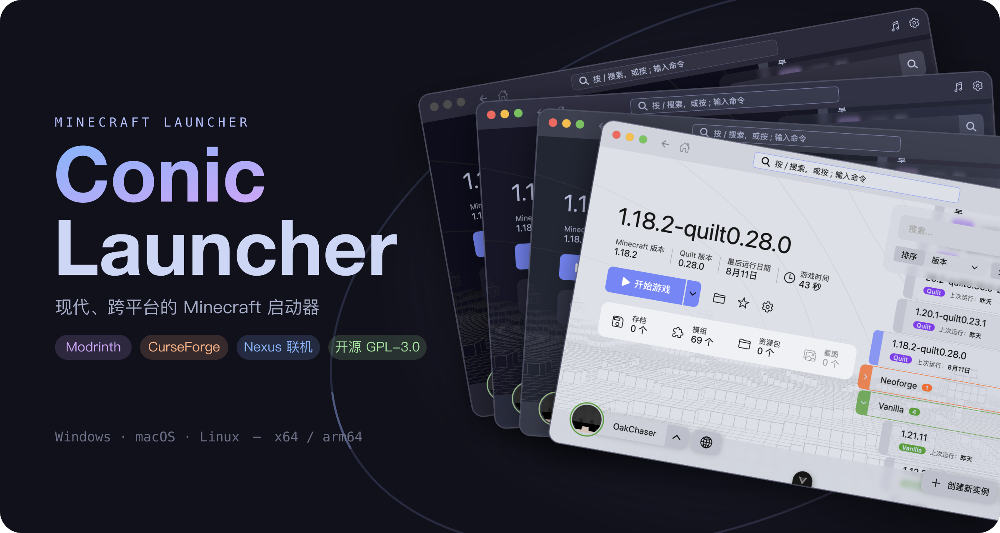

<div align="center">
  
  <p>
    <a href="https://github.com/conic-apps/launcher/actions/workflows/build.yml"></a>
    <a href="https://github.com/conic-apps/launcher/releases"></a>
    <a href="../../LICENSE"></a>
    <a href="https://discord.gg/xWKY5NMuf7"></a>
  </p>
  <p><strong>Um launcher de Minecraft pequeno, rápido e ágil</strong></p>
  <p>
    🌐 <a href="../../README.md">English</a> · <a href="./README.zh_cn.md">简体中文</a> · <a href="./README.zh_tw.md">繁體中文</a> · <a href="./README.ja_jp.md">日本語</a> · <a href="./README.ko_kr.md">한국어</a> · <a href="./README.de_de.md">Deutsch</a> · <a href="./README.fr_fr.md">Français</a> · <a href="./README.es_es.md">Español</a> · <a href="./README.pt_br.md"><strong>Português (Brasil)</strong></a> · <a href="./README.ru_ru.md">Русский</a> · <a href="./README.tr_tr.md">Türkçe</a> · <a href="./README.pl_pl.md">Polski</a>
  </p>
</div>

---

## O que é isso

O Conic Launcher é um launcher de Minecraft para desktop pequeno, rápido e leve, implementado em Rust,
com interface construída em [Slint](https://slint.dev). Instalação pequena, inicialização rápida e
baixo consumo de recursos — ele até ajuda a reduzir as emissões de CO₂.

> O projeto está em fase Alpha inicial; os recursos e a interface evoluem rapidamente. Experimente e
> reporte problemas.

## Funcionalidades

### Gerenciamento de múltiplas instâncias

Navegue pelas instâncias agrupadas por loader de mods, com ordenação, busca e favoritos; cada
instância pode ter suas próprias configurações especiais.

https://github.com/user-attachments/assets/ad4678ee-8462-4e55-89f6-99aea41107cb

### Suporte para todos os principais loaders

Suporte completo a Forge, NeoForge, Fabric e Quilt.

https://github.com/user-attachments/assets/73d28bc7-e743-4d16-b126-7b997eae797e

### Marketplace de mods e pacotes de recursos

Busca integrada no Modrinth e no CurseForge: veja detalhes dos projetos e dependências dentro do
launcher, instale um mod ou pacote de recursos em uma instância com um clique e gerencie diretamente
os mods instalados localmente.

https://github.com/user-attachments/assets/78f9e850-473e-4587-92b4-c9bed78afb17

### Multijogador cross-LAN Conic Nexus

Nenhuma ferramenta extra é necessária: crie um grupo, envie o código de convite a um amigo e entrem
juntos no mesmo mundo. O launcher detecta seu ambiente de rede (tipo de NAT) e sugere melhorias.


### Múltiplos métodos de login

Suporta login da Microsoft (fluxo de código de dispositivo), login offline e qualquer servidor de
autenticação externo Authlib-Injector / Yggdrasil.


### Experiência de inicialização tranquila

https://github.com/user-attachments/assets/1a6943f9-4e35-4391-9984-799cf42ee49d

### Saves e dados do jogo

Navegue pelos mapas dos mundos salvos, gerencie data packs e pacotes de recursos e veja as capturas
de tela do jogo, tudo dentro do launcher.

https://github.com/user-attachments/assets/195afb69-8c9f-4d83-aa40-50e7b4d61788

### Interface e personalização

Quatro temas Catppuccin (Mocha · Macchiato · Frappé · Latte), além de variantes de alto contraste;
fundos personalizados e música de fundo do launcher são suportados.

https://github.com/user-attachments/assets/5a262ff9-2ba8-45d4-b326-38f5d3911a80

https://github.com/user-attachments/assets/2847ea70-35e0-4ecc-9055-777f7545a260

## Download

Baixe o instalador para a sua plataforma no
[GitHub Releases](https://github.com/conic-apps/launcher/releases) ou no
[site oficial](https://conicmc.app):

| Plataforma | Arquitetura           | Formatos             |
| ---------- | --------------------- | -------------------- |
| Windows    | x64 · arm64           | MSI · exe portátil   |
| macOS      | Apple Silicon · Intel | DMG                  |
| Linux      | x64 · arm64           | deb · rpm · AppImage |

> Requer macOS 11.0 (Big Sur) ou superior.

> Se você usar a versão de arquivo único no Windows, verifique se existe um `VCRUNTIME140.dll` válido
> no sistema.

## Compilar a partir do código-fonte

Certifique-se de que o [Rust 1.88+](https://rustup.rs/) está instalado; no Linux, você também precisa
das [dependências de compilação](../../CONTRIBUTING.md#linux-build-dependencies).

```bash
git clone https://github.com/conic-apps/launcher.git
cd launcher
cargo run              # Desenvolvimento e depuração
cargo build --release  # Build de produção
```

## Contribuir

Contribuições são bem-vindas! Leia o [CONTRIBUTING.md](../../CONTRIBUTING.md) para saber como
começar, configurar seu ambiente de desenvolvimento e enviar um pull request.

## Licença

Este projeto é distribuído sob a [GPL-3.0](../../LICENSE), junto com todos os termos adicionais da
Seção 7 da GPLv3.

## Agradecimentos

- [Catppuccin](https://catppuccin.com) — cores de tema suaves e bonitas
- [forge-install-bootstrapper](https://github.com/bangbang93/forge-install-bootstrapper) por
  bangbang93 — bootstrap da instalação do Forge
- [MCIM](https://mod.mcimirror.top) — traduções chinesas do CurseForge e cache de espelho
- [HMCL](https://github.com/HMCL-dev/HMCL) — tratamento de crashes
- [XMCL](https://github.com/Voxelum/x-minecraft-launcher) — referência para o fluxo de análise de
  mods locais

## Aviso legal

O Conic Launcher não é um produto oficial do Minecraft e não é aprovado nem associado à Mojang
Studios. “Minecraft” é uma marca registrada da Mojang AB. Qualquer uso da marca Minecraft neste
projeto está em conformidade com as
<a href="https://www.minecraft.net/en-us/terms#terms-brand_guidelines">Diretrizes de Marca e
Ativos</a> da Mojang Studios.
